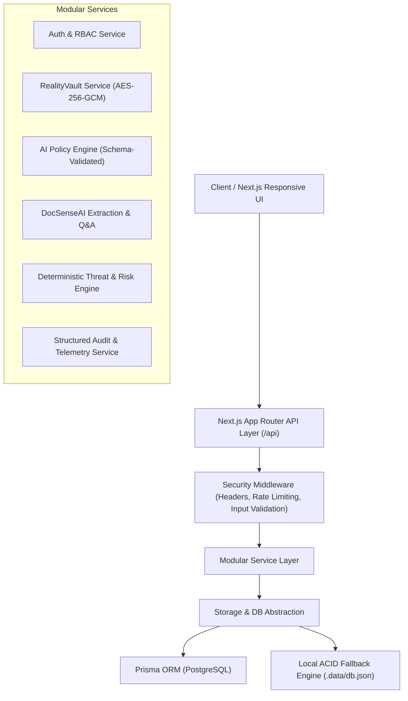

# RealityVault AI + DocSenseAI Architecture Specification

## 1. Executive Summary

**RealityVault AI** is a security-focused information platform combining AI-driven adaptive security policies with authenticated cryptography, zero-trust verification flows, and document intelligence (**DocSenseAI**).

### Core Principle
> **AI RECOMMENDS. BACKEND DECIDES. CRYPTOGRAPHY ENFORCES.**
> 
> An LLM is never the final authorization authority. Human intent is translated into structured policies, verified against strict deterministic schemas by the backend, and enforced through authenticated encryption (AES-256-GCM) and atomic state machines.

---

## 2. System Architecture



---

## 3. Technology Stack

- **Frontend**: Next.js 16 (App Router), React 19, TypeScript 5, Tailwind CSS, Lucide Icons.
- **Backend**: TypeScript / Next.js Route Handlers, modular service architecture.
- **Database**: PostgreSQL with Prisma ORM; automatic resilient local persistence fallback for development and self-contained demonstrations.
- **Cryptography**: Node.js Cryptography Engine (`AES-256-GCM` with 96-bit unique IVs and 128-bit authentication tags; PBKDF2/scrypt key derivation).
- **Document Processing**: Structured parser, multi-page chunking, entity & obligation extractor, source-grounded vector/keyword retrieval.

---

## 4. Domain Modules

### Module 1: RealityVault AI
1. **Secure Item Creation**: Encrypts secret message/document payload using `AES-256-GCM` before database persistence.
2. **Access Identifier**: Non-enumerable 256-bit cryptographic access token.
3. **Adaptive Verification Flow**:
   - Recipient identification.
   - OTP challenge (salted verification).
   - Trusted device fingerprint check.
   - Time-window / expiration verification.
4. **Atomic Consumption**:
   - Single-use items (`maxViews: 1`) transition atomically from `ACTIVE` to `CONSUMED`.
   - Concurrent requests are serialized; second attempt receives `ALREADY CONSUMED` status.
5. **Lifecycle Controls**: Expiration, manual revocation, secure destruction.

### Module 2: DocSenseAI
1. **Multi-Format Extraction**: Text and metadata parsing from uploaded documents.
2. **Chunking & Traceability**: Preserves exact page numbers, sections, and source chunk references.
3. **Structured AI Analysis**:
   - Executive Summary
   - Critical Deadlines
   - Legal/Contractual Obligations
   - Financial Figures & Payment Terms
   - Inconsistencies & Anomaly Flags
4. **Ask Your Document (Q&A)**: Grounded question-answering with page citations. Does not hallucinate non-existent pages or content.

### Module 3: Combined Mode
End-to-end integration workflow:
1. User uploads a sensitive document to DocSenseAI.
2. DocSenseAI analyzes financial risks, obligations, and confidential sections.
3. User triggers "Securely Share".
4. User enters natural-language security instructions (e.g., *"Send to manager, one-time view, OTP required, expire tomorrow"*).
5. AI Policy Engine compiles instructions into a validated schema.
6. RealityVault encrypts document with AES-256-GCM and generates a secure link.
7. Receiver undergoes verification, reveals document, and item is consumed atomically.
8. Security Center records non-sensitive audit telemetry.

### Module 4: Security Center & Threat Engine
- Real-time monitoring of access attempts, failures, and anomalous patterns.
- Risk scoring: `LOW`, `MEDIUM`, `HIGH`, `CRITICAL`.
- Clean audit logs ensuring zero secret leakage.

### Module 5: Secure Meetings
- Meeting lobby architecture with verified participant policies, security locks, and secure document attachment.

---

## 5. Directory Structure

```
/src
  /app
    /api
      /auth
      /vault
      /documents
      /security
      /audit
      /meetings
      /health
    /dashboard
    /vault
    /docsense
    /combined
    /security-center
    /meetings
    layout.tsx
    page.tsx
    globals.css
  /components
    /common
    /layout
    /vault
    /docsense
    /security
  /lib
    /crypto (AES-256-GCM implementation)
    /db (Database client & storage adapter)
    /logger (Structured sanitizing logger)
    /security (Headers, rate limiting, validation)
    /config (Environment parsing)
  /services
    /ai (Policy engine & document analyzer)
    /vault (Secure item management)
    /documents (Ingestion & Q&A)
    /security (Risk engine & verification)
    /audit (Audit event logger)
  /types
/prisma
  schema.prisma
/docs
  architecture.md
  security-baseline.md
```
